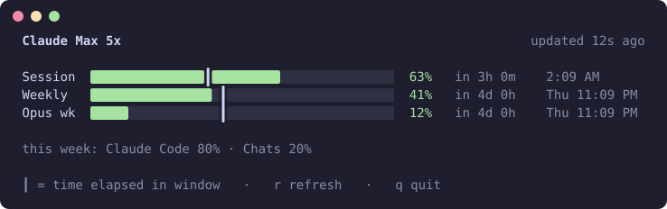
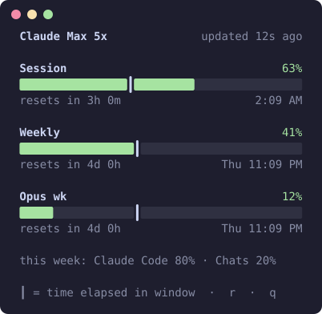
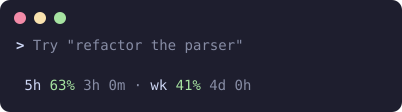

# cusage

Your Claude Pro or Max plan usage in the terminal: session and weekly limits, when they reset, and whether you're burning through them faster than the clock. Keep it open in a side pane, or put it in Claude Code's status line where it updates after every response.

[](https://github.com/William-Ger/cusage/actions/workflows/ci.yml)
[](LICENSE)


<p>
  
</p>

## Features

- **The numbers behind `/usage`**: the 5-hour session, the weekly limit, and any per-model weekly limits on your plan.
- **Pace tick**: a `┃` on each bar marks how far through the window you are. Fill past the tick means you'll run out before it resets.
- **Live inside Claude Code**: `cusage install` adds a status line that updates after every response, and the side-pane view picks up the same numbers within a second.
- **Fits any pane**: one row per limit when there's room, stacked cards when it's narrow. Nothing wraps, down to 12 columns.
- **Rate-limit aware**: the usage API only allows about one request every two minutes, so every cusage command shares one cache, backs off after a 429, and keeps showing the last good numbers.
- **No setup, no dependencies**: it uses the login Claude Code already has. One file per concern, plain Node.

<p>
  
</p>

## Install

Requires Node 20 or later and [Claude Code](https://claude.com/claude-code) logged in with a Claude Pro or Max plan.

```sh
npm install -g github:William-Ger/cusage
```

Works on macOS and Linux. Windows should work but is untested.

## Quick start

```sh
cusage            # show usage once
cusage watch      # live view for a side pane (r refresh, q quit)
cusage install    # live numbers in Claude Code's status line
```

A small split works well for `cusage watch`. In Ghostty, open one with `cmd+d` (or `ctrl+shift+o` on Linux) and run it there.

## Live numbers in Claude Code

<p>
  
</p>

After every response, Claude Code sends your current session and weekly usage to its [status line](https://code.claude.com/docs/en/statusline) command. `cusage install` makes cusage that command. It then:

- shows `5h 63% 3h 0m · wk 41% 4d 0h` under the prompt in every Claude Code session
- saves the numbers so `cusage` and `cusage watch` show them within a second, with no API request

If you already have a status line, it's kept: cusage runs your command and adds its segment after it. `cusage uninstall` puts your old status line back exactly as it was. Both commands save a backup of your settings to `~/.claude/settings.json.cusage.bak` first.

Per-model weekly limits and usage from claude.ai chats aren't in the status-line data, so those still come from the API every two minutes.

## Commands

| Command | What it does |
| --- | --- |
| `cusage` | Show usage once. |
| `cusage watch [secs]` | Full-screen live view. Polls the API every `secs` (default 120, minimum 60) and redraws every second. `r` refreshes, `q` quits. |
| `cusage line` | One line, e.g. `S 63% 3h 0m │ W 41% 4d 0h`, for shell prompts and tmux or other status bars. |
| `cusage json` | The raw API response. |
| `cusage install` | Set cusage as Claude Code's status line. |
| `cusage uninstall` | Undo `install`. |
| `cusage statusline` | The status-line command itself. Reads Claude Code's JSON on stdin. |

Add `--no-color` to any command, or set `NO_COLOR`, for plain output. The old flags (`-w`, `--line`, `--json`, `--statusline`) still work.

## Reading the display

- **Bar color**: green under 70%, yellow from 70%, red from 90%.
- **`┃` pace tick**: the share of the window that has passed. At 63% used with the tick at 40%, you're using this limit faster than it refills.
- **`updated 12s ago`**: the age of the numbers. It turns yellow after 4 minutes, which usually means the API is rate-limiting you and no Claude Code session has sent fresh numbers.
- **`resets in 3h 0m   2:09 AM`**: the countdown and the local reset time.

## How it works

1. **Credentials.** Claude Code stores its OAuth login in the macOS Keychain (`Claude Code-credentials`), or in `~/.claude/.credentials.json` on Linux and Windows. cusage reads the access token from there. It never refreshes or rewrites it; Claude Code does that.
2. **Usage API.** It calls `GET https://api.anthropic.com/api/oauth/usage`, the endpoint behind Claude Code's `/usage`. It allows a short burst and then about one request every two minutes. The last response is cached in `~/.cache/cusage/usage.json` and reused when it's under a minute old or when a request fails.
3. **Live snapshot.** When cusage is your status line, each run writes the session and weekly numbers to `~/.cache/cusage/live.json`. Every view merges them over the cached API response when they're newer.

| File | Contents |
| --- | --- |
| `~/.cache/cusage/usage.json` | Last API response (percentages and reset times). |
| `~/.cache/cusage/live.json` | Last status-line snapshot. |
| `~/.config/cusage/config.json` | Your previous status line, if `install` replaced one. |
| `~/.claude/settings.json.cusage.bak` | Settings backup from the last `install` or `uninstall`. |

## Privacy

- Your token is only sent to `api.anthropic.com` over HTTPS. cusage never writes it to disk or prints it.
- Cache files hold usage percentages and reset times only, and are created readable by you alone.
- No telemetry, no other network requests.

## Environment variables

| Variable | Effect |
| --- | --- |
| `NO_COLOR` | Disable colors. |
| `CLAUDE_CONFIG_DIR` | Claude Code's config folder, if you moved it from `~/.claude`. Used for `settings.json` and `.credentials.json`. |
| `CUSAGE_CACHE_DIR` | Where cache files go. Defaults to `$XDG_CACHE_HOME/cusage` or `~/.cache/cusage`. |
| `XDG_CONFIG_HOME` | Parent folder of `cusage/config.json`. Defaults to `~/.config`. |

## Troubleshooting

**"No Claude Code login found"**: run `claude` and log in with `/login` using your Pro or Max account. API-key logins have no plan limits to show.

**"Token expired" or "Token rejected (401)"**: open Claude Code and send any message. It refreshes the token, and cusage picks it up on the next request.

**`updated` is yellow or shows a 429 warning**: the usage API is rate-limiting you, often because several things poll it. cusage keeps showing the last numbers and retries with a longer interval. Installing the status line avoids this.

**The status line doesn't appear**: send a message in Claude Code. The numbers only arrive after the first response in a session.

## Development

```sh
git clone https://github.com/William-Ger/cusage && cd cusage
npm test          # node:test, no dependencies
npm run demo      # regenerate the SVGs in docs/ from sample data
npm link          # put your checkout on PATH as `cusage`
```

The code is split into `src/usage.mjs` (credentials, API, cache, live data), `src/render.mjs` (layout at any width), `src/install.mjs` (status-line setup), and `bin/cusage.mjs` (the CLI). Issues and pull requests are welcome.

## Disclaimer

cusage is an independent project, not affiliated with or endorsed by Anthropic. It relies on an undocumented endpoint that may change without notice. If it breaks, please open an issue.

## License

[MIT](LICENSE)
